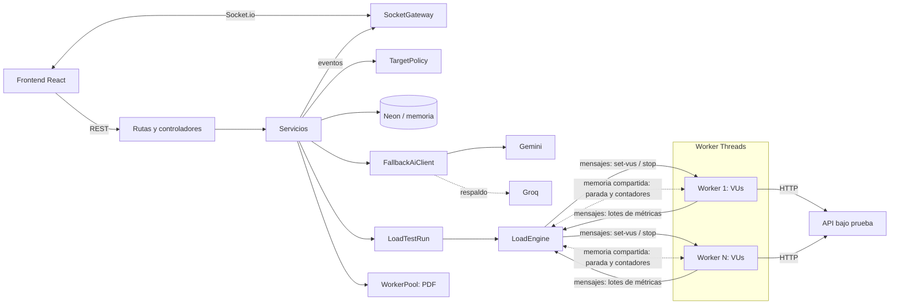

# Testeador de Carga Visual: Backend

API y motor de carga que simula usuarios concurrentes contra un endpoint propio y mide en tiempo real su latencia (p50, p95, p99), su throughput y su tasa de errores. Además, una IA (Gemini, con Groq de respaldo) analiza cada prueba terminada.

**Autor:** Julián David Moreno · Programación orientada a la web

| | |
|---|---|
| Frontend (Vercel) | <https://testeador-carga-frontend-ruddy.vercel.app> · [repositorio](https://github.com/JulianMoreno627/TESTEADOR-CARGA-FRONTEND) |
| Backend (Render) | <https://testeador-carga-api.onrender.com> |
| API de ejemplo verificada | <https://testeador-carga-demo.onrender.com> |
| Base de datos | PostgreSQL en Neon |

En el plan gratuito, Render apaga el servicio tras 15 minutos sin uso: la primera visita puede tardar cerca de un minuto.

## Documentación

| Documento | Contenido |
|---|---|
| [contract/openapi.yaml](contract/openapi.yaml) | Contrato OpenAPI 3.1: la fuente de verdad de la API |
| [docs/API.md](docs/API.md) | Guía del contrato para el frontend, incluidos los eventos de Socket.io |
| [docs/PARADIGMAS-Y-TRADE-OFFS.md](docs/PARADIGMAS-Y-TRADE-OFFS.md) | Paradigmas usados y lo que se ganó y pagó con cada decisión |
| [docs/DESPLIEGUE.md](docs/DESPLIEGUE.md) | Paso a paso para desplegar en Neon, Render y Vercel |

## Puesta en marcha local

Requiere Node.js 22.9 o superior.

```bash
npm install
cp .env.example .env   # pon tus valores reales solo en .env
npm run dev            # backend en http://localhost:3000
npm run demo:target    # en otra terminal: API de ejemplo en http://localhost:4000
```

| Variable | Sin ella |
|---|---|
| `DATABASE_URL` | El historial se guarda en memoria y se pierde al reiniciar |
| `GEMINI_API_KEY`, `GROQ_API_KEY` | El análisis con IA responde que no está configurado |

Las tablas se crean solas al arrancar. Para las pruebas automáticas usa `npm test`: no necesitan base de datos, red ni claves.

## Cómo cubre los temas de la materia

| Tema | Dónde | Detalle |
|---|---|---|
| **Manejo de hilos** | [SharedControl.js](src/engine/SharedControl.js) | Memoria compartida con `SharedArrayBuffer` y `Atomics` entre el hilo principal y los workers |
| **Workers** | [LoadEngine.js](src/engine/LoadEngine.js), [WorkerPool.js](src/workers/WorkerPool.js) | Worker Threads que generan la carga, y un pool que dibuja los PDF fuera del event loop |
| **CSR, SSR, SSG e ISR** | [rendering/](src/rendering/) | Cada vista con el patrón que mejor le sirve (ver la tabla de abajo) |
| **Paradigma y trade-offs** | [PARADIGMAS-Y-TRADE-OFFS.md](docs/PARADIGMAS-Y-TRADE-OFFS.md) | Orientado a eventos (Observer), con OOP, funciones puras y concurrencia donde encajan |
| **Contract-first** | [contract/openapi.yaml](contract/openapi.yaml), [tests/contract/](tests/contract/) | El contrato se escribe antes que el código y las respuestas reales se validan contra él |
| **Métricas de rendimiento** | [LatencyHistogram.js](src/domain/metrics/LatencyHistogram.js), [ServerMetricsService.js](src/services/ServerMetricsService.js) | Percentiles sobre flujos de datos; event loop, CPU, memoria y `Server-Timing` |
| **IA** | [src/ai/](src/ai/) | Gemini con respaldo automático a Groq y circuit breaker |

## Arquitectura



```text
src/
├── index.js         Entrada: arranque y apagado ordenado
├── bootstrap.js     Raíz de composición: crea y conecta las dependencias
├── app.js           Aplicación Express y sus middlewares
├── config/          Variables de entorno validadas
├── api/             Capa HTTP: rutas, controladores, middlewares y esquemas
├── services/        Casos de uso: pruebas, análisis, reportes, dominios y métricas
├── domain/          Lógica pura: percentiles, patrones de carga, comparación
├── engine/          Motor de carga y memoria compartida
│   └── worker/      Código que corre dentro de cada Worker Thread
├── workers/         Pool genérico de Worker Threads
├── ai/              Proveedores de IA, respaldo y circuit breaker
├── realtime/        Socket.io
├── rendering/       Vistas HTML, caché ISR, archivos SSG y PDF
├── repositories/    Persistencia: PostgreSQL y memoria
├── database/        Conexión y migraciones SQL
└── shared/          Errores, logger y utilidades de red
contract/            Contrato OpenAPI (fuente de verdad)
tests/               Unitarias, de integración y de contrato
```

Las dependencias van en un solo sentido: `api → services → domain`. `domain` no conoce Express, Socket.io ni SQL, y por eso se prueba sin levantar nada.

### Patrones de diseño

| Patrón | Dónde | Para qué |
|---|---|---|
| Observer | [LoadTestService.js](src/services/LoadTestService.js) | Avisar a WebSockets y cachés sin acoplarlos al servicio |
| Strategy | [loadPatterns.js](src/domain/loadPatterns.js), [providers/](src/ai/providers/) | Agregar un patrón de carga o un proveedor de IA sin tocar a quien lo usa |
| Repository | [repositories/](src/repositories/) | Cambiar PostgreSQL por memoria sin tocar los servicios |
| Circuit breaker | [CircuitBreaker.js](src/ai/CircuitBreaker.js) | Dejar de esperar a un proveedor de IA que está fallando |
| Inyección de dependencias | [bootstrap.js](src/bootstrap.js) | Sustituir dependencias en las pruebas (por ejemplo, una IA simulada) |

## Detalles de cada tema

### Hilos y workers

- **Generar la carga.** El [`LoadEngine`](src/engine/LoadEngine.js) reparte los usuarios virtuales entre Worker Threads. En cada uno, cada VU es un bucle asíncrono que espera su respuesta antes de enviar la siguiente petición.
- **Dos formas de comunicarse.** Los lotes de métricas viajan por mensajes. La orden de parar y los contadores en vivo (VUs activos, peticiones en vuelo) usan memoria compartida con `Atomics`, que no copia datos y se lee al instante.
- **Pool para tareas de CPU.** Dibujar un PDF bloquearía el event loop, así que lo hace el [`WorkerPool`](src/workers/WorkerPool.js), que mantiene hilos vivos y encola las tareas. El resultado vuelve como un `ArrayBuffer` transferido, sin copia.

### Métricas de rendimiento

- **De la API bajo prueba.** El [`LatencyHistogram`](src/domain/metrics/LatencyHistogram.js) calcula percentiles con cubetas logarítmicas (la idea de DDSketch):
  - Ocupa memoria acotada.
  - El error relativo máximo es del 1 %.
  - Se puede combinar entre workers: se suman los histogramas, nunca se promedian los percentiles.
- **Del propio backend.** `GET /api/v1/metrics` expone:
  - el retardo y el uso del event loop, la CPU y la memoria;
  - la latencia por ruta;
  - indicadores como `inFlightRequests` (leído de la memoria compartida) o `pdfWorkersBusy`.

  Cada respuesta lleva además la cabecera `Server-Timing`.

### Tiempo real sin saturar la conexión

Los workers agrupan sus resultados cada 100 ms y el hilo principal los combina en un punto por segundo. Ese punto se envía por Socket.io solo a quienes siguen la prueba, como mensaje `volatile`: si un cliente va atrasado, el punto se descarta en lugar de acumularse.

### Patrones de renderizado

La cabecera `X-Render-Strategy` indica cuál usa cada respuesta. Los tiempos de servidor se midieron en producción.

| Patrón | Ruta | Tiempo de servidor | Por qué |
|---|---|---|---|
| **CSR** | `/api/v1/*` y Socket.io | 3,1 ms (solo datos) | El dashboard en vivo se dibuja en el navegador |
| **SSR** | `/views/compare` | 7,6 ms | El resultado depende de cada petición |
| **SSG** bajo demanda | `/views/reports/:id` | 1,4 ms | Una corrida terminada no cambia; se regenera solo si recibe su análisis con IA |
| **ISR** | `/views/history` | 0,6 ms | Responde desde caché y se renueva en segundo plano |

### Contract-first

1. Se modifica [contract/openapi.yaml](contract/openapi.yaml) y se publica en `/api/v1/openapi.yaml`.
2. Se implementa el backend. [tests/contract/](tests/contract/) valida cada respuesta real contra los esquemas y falla si alguna operación del contrato queda sin probar.
3. El frontend descarga el contrato con `npm run contract:sync`, y su prueba comprueba que cada llamada exista en él.

En el historial de git se ve que el contrato del análisis con IA y el de `/health/live` se publicaron antes que su código.

### Análisis con IA

`POST /api/v1/load-tests/{id}/analysis` resume la prueba sin credenciales y se la envía a Gemini. La respuesta se valida con Zod antes de guardarla.

- **Si Gemini falla** (error, tiempo agotado o JSON inválido), responde Groq.
- **Si Gemini falla varias veces seguidas**, el circuit breaker lo omite durante un minuto.
- **El análisis se guarda en Neon y se genera una sola vez por corrida**, así se cuida la cuota gratuita.

### Uso responsable

[`TargetPolicy`](src/services/TargetPolicy.js) impide usar la herramienta como arma de denegación de servicio:

- **Dominios públicos:** solo si su dueño demuestra que lo controla, con un archivo en `/.well-known/` o un registro TXT de DNS.
- **Redes internas:** siempre bloqueadas, incluidos los metadatos de nube (`169.254.169.254`).
- **localhost:** solo con `ALLOW_LOCALHOST=true`; en producción está desactivado.
- **Conexiones:** el motor solo se conecta a las IP ya validadas (sin DNS rebinding), y la cabecera `Host` no se puede modificar.
- **Límites y trazabilidad:** hay límites de VUs, duración, pruebas simultáneas y solicitudes por minuto, y cada petición lleva `X-Load-Test-Id`.

Las credenciales de los headers y de la URL se ocultan antes de guardar, y el cuerpo de la petición no se almacena. `sh scripts/check-secrets.sh` revisa que ningún commit lleve claves antes de subirlo.

## Resultados medidos

| Prueba | Esperado | Medido |
|---|---|---|
| `/slow`, retardo de 100 a 300 ms (local) | p50 ≈ 200 ms | 206 ms |
| `/flaky`, 10 % de fallos (local) | 10 % de errores | 10,01 % |
| `/heavy`, 5 ms bloqueantes con 50 VUs (local) | ≈ 200 req/s y ≈ 250 ms | 192 req/s y 257 ms |
| `/slow` con 20 VUs en rampa (producción, Render Free) | p50 ≈ 200 ms y sin errores | 224 ms y 0 % |
| `/flaky` con 10 VUs (producción) | 10 % de errores | 10,8 %; Gemini lo marcó como "degradada" |

En local, con 500 VUs a unos 2500 req/s, el hilo principal se mantuvo por debajo del 8 % de uso y `/api/v1/metrics` respondió con un p95 de 1,6 ms.

## Limitaciones conocidas

- **Sin cuentas de usuario.** Quien acceda a la API puede ver, detener o borrar cualquier prueba. La verificación de dominio impide atacar a terceros, pero un servicio público real necesitaría autenticación.
- **Modelo cerrado.** Cada VU espera su respuesta antes de seguir, así que si el servidor se degrada también baja la tasa de peticiones y los percentiles pueden subestimar la espera real (*coordinated omission*).
- **Un solo proceso.** Las pruebas activas viven en memoria. Si el proceso se cae, se marcan como fallidas al reiniciar.
- **Plan gratuito.** En Render hay 0,1 CPU y 512 MB: el despliegue limita las pruebas a 200 VUs, 120 s y una a la vez.
