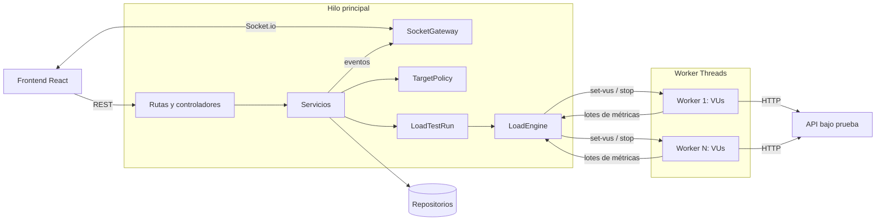

# Testeador de Carga Visual: Backend

API y motor de carga que simula usuarios concurrentes contra un endpoint propio y mide en tiempo real su latencia (p50, p95, p99), su throughput y su tasa de errores. El frontend vive en otro repositorio y se conecta usando el contrato de [docs/API.md](docs/API.md).

## Puesta en marcha

Requiere Node.js 22.9 o superior.

```bash
npm install
cp .env.example .env
```

El historial se puede guardar de tres formas, según el valor de `DATABASE_URL` en `.env`:

| Opción | Qué hacer |
|---|---|
| PostgreSQL con Docker | Ejecuta `docker compose up -d` y deja el valor del ejemplo |
| PostgreSQL ya instalado | Crea una base de datos y apunta `DATABASE_URL` a ella |
| Sin base de datos | Borra la línea. El historial se pierde al reiniciar |

Las tablas se crean solas al arrancar. Después, en dos terminales:

```bash
npm run dev          # backend en http://localhost:3000
npm run demo:target  # API de ejemplo en http://localhost:4000
```

Lanza una prueba contra la API de ejemplo:

```bash
curl -X POST http://localhost:3000/api/v1/load-tests \
  -H "Content-Type: application/json" \
  -d '{"name":"Mi primera prueba","url":"http://localhost:4000/slow","vus":100,"durationSeconds":15,"pattern":{"type":"ramp"}}'
```

Al terminar, abre <http://localhost:3000/views/history> para ver el resultado. Para ejecutar las pruebas automáticas usa `npm test`.

## Arquitectura



```text
src/
├── index.js         Entrada: arranque y apagado ordenado
├── bootstrap.js     Raíz de composición: crea y conecta las dependencias
├── app.js           Aplicación Express y sus middlewares
├── config/          Variables de entorno validadas
├── api/             Capa HTTP: rutas, controladores, middlewares y esquemas
├── services/        Casos de uso y reglas de negocio
├── domain/          Lógica pura: percentiles, patrones de carga, comparación
├── engine/          Motor de carga
│   └── worker/      Código que corre dentro de cada Worker Thread
├── realtime/        Socket.io
├── rendering/       Vistas HTML, caché ISR, archivos SSG y PDF
├── repositories/    Persistencia: PostgreSQL y memoria
├── database/        Conexión y migraciones SQL
└── shared/          Errores, logger y utilidades de red
```

Las dependencias van en un solo sentido: `api → services → domain`. `domain` no conoce Express, Socket.io ni SQL, y por eso se prueba sin levantar nada.

### Patrones de diseño

| Patrón | Dónde | Para qué |
|---|---|---|
| Strategy | [loadPatterns.js](src/domain/loadPatterns.js) | Agregar un patrón de carga sin tocar el motor |
| Repository | [repositories/](src/repositories/) | Cambiar PostgreSQL por memoria sin tocar los servicios |
| Observer | [LoadTestService.js](src/services/LoadTestService.js) | Avisar a WebSockets y a la caché sin acoplarlos al servicio |
| Inyección de dependencias | [bootstrap.js](src/bootstrap.js) | Sustituir dependencias en las pruebas |

## Cómo se cumple cada requisito

### Workers y concurrencia

El [`LoadEngine`](src/engine/LoadEngine.js) reparte los usuarios virtuales (VUs) entre varios Worker Threads. Dentro de cada uno, cada VU es un bucle asíncrono que espera su respuesta antes de enviar la siguiente petición. Generar tráfico fuera del hilo principal mantiene libres la API y los WebSockets, aunque la prueba sea exigente.

### Métricas de rendimiento

**De la API bajo prueba.** El [`LatencyHistogram`](src/domain/metrics/LatencyHistogram.js) calcula percentiles sobre el flujo de datos con cubetas logarítmicas (la idea de DDSketch):

- Ocupa memoria acotada, sin importar cuántas peticiones se midan.
- Tiene un error relativo máximo del 1 %.
- Se puede combinar. Promediar el p95 de cada worker daría un resultado incorrecto, así que se suman sus histogramas y el percentil se calcula sobre el total.

**Del propio backend.** `GET /api/v1/metrics` expone el retardo y el uso del event loop, CPU, memoria y latencia por ruta. Además, cada respuesta lleva la cabecera `Server-Timing`, visible en la pestaña Network de DevTools.

### Tiempo real sin saturar la conexión

Los datos se reducen en tres etapas:

1. Cada worker agrupa sus resultados en un lote cada 100 ms.
2. El hilo principal los combina en un solo punto por segundo.
3. El punto se envía solo a quienes siguen esa prueba, como mensaje `volatile`: si un cliente va atrasado, se descarta en lugar de acumularse.

### Patrones de renderizado

Cada vista usa el patrón que mejor le sirve. La cabecera `X-Render-Strategy` permite comprobarlo.

| Patrón | Ruta | Por qué |
|---|---|---|
| **CSR** | `/api/v1/*` y Socket.io | El dashboard en vivo se dibuja en el navegador con estos datos |
| **SSR** | `/views/compare` | El resultado depende de los parámetros de cada petición |
| **SSG** bajo demanda | `/views/reports/:id` | Una corrida terminada no cambia: se genera una vez y se sirve como archivo |
| **ISR** | `/views/history` | Cambia poco: responde desde caché y se renueva en segundo plano |

### Uso responsable

[`TargetPolicy`](src/services/TargetPolicy.js) impide usar la herramienta como arma de denegación de servicio:

- **Dominios públicos:** solo si su dueño demuestra que lo controla, con un archivo en `/.well-known/` o un registro TXT de DNS.
- **Redes internas:** siempre bloqueadas, incluidos los metadatos de nube (`169.254.169.254`).
- **localhost:** solo con `ALLOW_LOCALHOST=true`, que en producción está desactivado por defecto.
- **DNS rebinding:** el motor se conecta solo a las IP ya validadas.
- **Cabecera `Host`:** no se puede modificar, para evitar apuntar a otro dominio.
- **Límites:** máximo de VUs, duración, pruebas simultáneas y solicitudes por minuto.
- **Trazabilidad:** cada petición lleva la cabecera `X-Load-Test-Id`.

Las credenciales de los headers y de la URL se ocultan antes de guardar, y el cuerpo de la petición no se almacena.

## Resultados de una corrida real

Medidos en la máquina de desarrollo, con 8 núcleos y el backend, PostgreSQL embebido (PGlite) y la API de ejemplo en el mismo equipo. Los valores dependen del hardware.

| Prueba | Esperado | Medido |
|---|---|---|
| `/slow`, retardo uniforme de 100 a 300 ms | p50 ≈ 200 ms | 206 ms |
| `/flaky`, 10 % de fallos | 10 % de errores | 10,01 % |
| `/heavy`, 5 ms bloqueantes con 50 VUs | ≈ 200 req/s y ≈ 250 ms | 192 req/s y 257 ms |

Con 500 VUs a unos 2500 req/s, el hilo principal se mantuvo por debajo del 8 % de uso y `/api/v1/metrics` respondió con un p95 de 1,6 ms.

## Limitaciones conocidas

- **Sin cuentas de usuario.** Quien acceda a la API puede ver, detener o borrar cualquier prueba. La verificación de dominio impide atacar a terceros, pero para exponerla en internet habría que añadir autenticación.
- **Modelo cerrado.** Cada VU espera su respuesta antes de seguir, así que si el servidor se degrada también baja la tasa de peticiones y los percentiles pueden subestimar la espera real (*coordinated omission*).
- **Un solo proceso.** Las pruebas activas viven en memoria. Si el proceso se cae, se marcan como fallidas al reiniciar.
- **Detrás de un proxy** hay que configurar `trust proxy` en Express para que el límite de solicitudes distinga a cada cliente.
